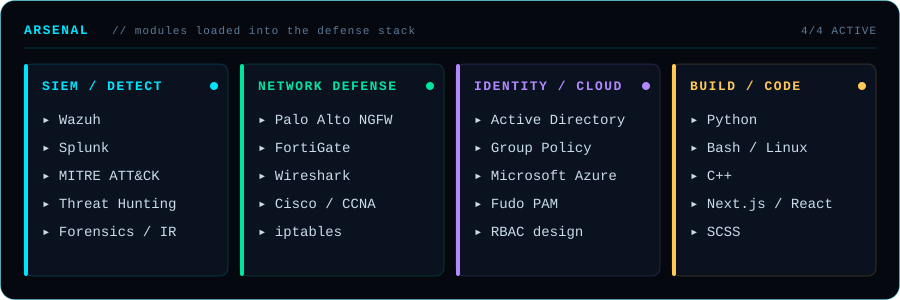

<p align="center">
  
</p>

<p align="center">
  <a href="https://www.linkedin.com/in/ayan-ismayilzade-2b04252b2/"></a>
  <a href="mailto:ayanismayilzade2006@gmail.com"></a>
  <a href="https://github.com/ayan863?tab=repositories"></a>
</p>

### `ayan@soc:~$ show running-config | section identity`

```diff
# ─── firewall policy: ayan.local ───────────────────────────────
+ ALLOW   role        → Blue Team · Junior SOC Analyst
+ ALLOW   cert        → Security Blue Team · BTJA
+ ALLOW   training    → Div Academy Blue Team — Honour Diploma
+ ALLOW   education   → Information Technology @ ASCCA (4th year)
+ ALLOW   focus       → detection engineering · firewall systems · hardening
+ ALLOW   path        → web developer  ──►  defender
- DENY    default-creds     any → any
- DENY    unpatched-systems any → any
- DENY    alert-fatigue     any → any
# ─── implicit deny all ─────────────────────────────────────────
```

### `ayan@soc:~$ tail -f /var/log/ayan/alerts.log`

| SEV | TIMESTAMP | RULE | EVENT |
|:---:|:---|:---|:---|
| 🟢 | `now` | `LEARN-01` | Studying **CCNA — Introduction to Networks** |
| 🔵 | `now` | `BUILD-07` | Shipping new features to **FIREWALL Network Manager** |
| 🟣 | `ongoing` | `HUNT-03` | Practising threat hunting with **Wazuh** & **Splunk** labs |
| 🟡 | `open` | `JOB-404` | Searching for a **first SOC / Blue Team role** — let's talk |

### `ayan@soc:~$ ls ./case-files`

<table>
<tr>
<td width="50%" valign="top">

**`CASE #001` · FIREWALL Network Manager**

Desktop app + web panel for managing host firewall rules on Linux.

- 🛡️ ICMP flood detection
- ⏱️ Time-scheduled rules
- 👥 Role-based access control (RBAC)

`Python` `Bash` `Linux` `Network Security`

<a href="https://github.com/ayan863/FIREWALL-Network-Manager-Project"></a>

</td>
<td width="50%" valign="top">

**`CASE #002` · Viva La Pizza**

Online pizza ordering web app with an admin panel — my full-stack roots.

- 🍕 Menu & ordering flow
- 🧑‍💼 Admin panel
- 🚀 Live on Netlify

`Next.js` `SCSS` `Web`

<a href="https://github.com/ayan863/viva-la-pizza"></a>
<a href="https://vivalapizza.netlify.app/"></a>

</td>
</tr>
</table>

### `ayan@soc:~$ lsmod | grep defense`

<p align="center">
  
</p>

### `ayan@soc:~$ cat /proc/telemetry`

<p align="center">
  
  
</p>

<p align="center">
  
</p>
